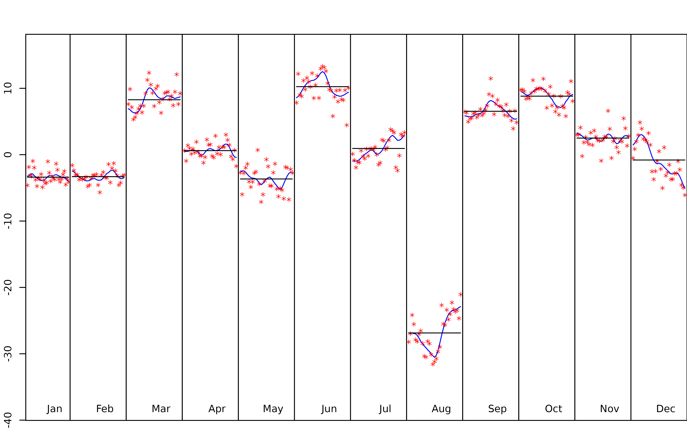
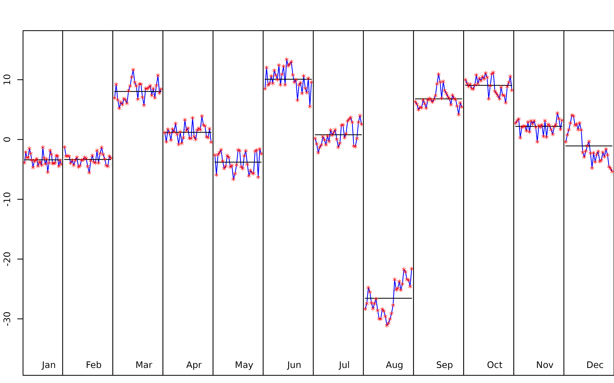

# rjdmarkdown with HTML output

The functions developped in `rjdmarkdown` are:

- [`print_preprocessing()`](../reference/print_preprocessing.md) for the
  pre-processing model;  
- [`print_decomposition()`](../reference/print_decomposition.md) for the
  decomposition;  
- [`print_diagnostics()`](../reference/print_diagnostics.md) to print
  diagnostics tests on the quality of the seasonal adjustment.

The result is different between X-13ARIMA and TRAMO-SEATS models.

``` r

library(rjdmarkdown)
library(RJDemetra)
sa_x13 <- x13(ipi_c_eu[, "FR"])
sa_ts <- tramoseats(ipi_c_eu[, "FR"])
```

## X-13-ARIMA model

``` r

print_preprocessing(sa_x13)
```

***Pre-processing (RegArima)***

***Summary***

372 observations

Trading days effect (7 variables)

Easter \[1\] detected

4 detected outliers

***Likelihood statistics***

Number of effective observations = 359

Number of estimated parameters = 17

Loglikelihood = -799.084, AICc = 1633.964, BICc = 1.855

Standard error of the regression (ML estimate) = 2.218

***ARIMA model***

[TABLE]

ARIMA coefficients {.table .table
style="margin-left: auto; margin-right: auto;border-bottom: 0;"}

***Regression model***

[TABLE]

Regression coefficients {.table .table
style="margin-left: auto; margin-right: auto;border-bottom: 0;"}

``` r

print_decomposition(sa_x13, caption = NULL)
```

***Decomposition (X-11)***

Mode: additive



S-I Ratio

|  | Value | Description |
|:---|:--:|:---|
| M-1 | 0.163 | The relative contribution of the irregular over three months span |
| M-2 | 0.089 | The relative contribution of the irregular component to the stationary portion of the variance |
| M-3 | 1.181 | The amount of period to period change in the irregular component as compared to the amount of period to period change in the trend |
| M-4 | 0.558 | The amount of autocorrelation in the irregular as described by the average duration of run |
| M-5 | 1.020 | The number of periods it takes the change in the trend to surpass the amount of change in the irregular |
| M-6 | 0.090 | The amount of year to year change in the irregular as compared to the amount of year to year change in the seasonal |
| M-7 | 0.083 | The amount of moving seasonality present relative to the amount of stable seasonality |
| M-8 | 0.244 | The size of the fluctuations in the seasonal component throughout the whole series |
| M-9 | 0.062 | The average linear movement in the seasonal component throughout the whole series |
| M-10 | 0.272 | The size of the fluctuations in the seasonal component in the recent years |
| M-11 | 0.256 | The average linear movement in the seasonal component in the recent years |
| Q | 0.368 |  |
| Q-M2 | 0.402 |  |
| **Final filters**: M3x5, Henderson-13 terms |  |  |

M-statistics {.table .table
style="margin-left: auto; margin-right: auto;border-bottom: 0;"}

|           | Component |
|:----------|:---------:|
| Cycle     |   2.251   |
| Seasonal  |  59.750   |
| Irregular |   1.067   |
| TD & Hol. |   2.610   |
| Others    |  33.718   |
| Total     |  99.395   |

Relative contribution of the components to the stationary portion of the
variance in the original series, after the removal of the long term
trend {.table .table style="margin-left: auto; margin-right: auto;"}

``` r

print_diagnostics(sa_x13)
```

[TABLE]

Diagnostics tests {.table .table
style="margin-left: auto; margin-right: auto;border-bottom: 0;"}

## TRAMO-SEATS model

Some others graphics can also be added with the
[`ggdemetra`](https://aqlt.github.io/ggdemetra/) package, for example to
add the seasonally adjusted series and its forecasts:

``` r

library(ggdemetra)
ggplot(data = ipi_c_eu_df, mapping = aes(x = date, y = FR)) +
    geom_line() +
    labs(title = NULL,
         x = NULL, y = NULL) +
    geom_sa(component = "y_f", linetype = 2,
            frequency = 12, method = "tramoseats") + 
    geom_sa(component = "sa", color = "red") +
    geom_sa(component = "sa_f", color = "red", linetype = 2)
```


Seasonal adjustment of the French industrial production index

``` r

print_preprocessing(sa_ts)
```

***Pre-processing (Tramo)***

***Summary***

372 observations

Trading days effect (2 variables)

Easter \[6\] detected

4 detected outliers

***Likelihood statistics***

Number of effective observations = 359

Number of estimated parameters = 11

Loglikelihood = -816.075, AICc = 1654.912, BICc = 1.852

Standard error of the regression (ML estimate) = 2.326

***ARIMA model***

|  | Coefficients | Std. Error | T-stat | P (\> \| t\|) |  |
|:---|:--:|:--:|:--:|:--:|:--:|
| Phi(1) | 0.403 | 0.051 | 7.845 | 0.000 | \*\*\* |
| Phi(2) | 0.288 | 0.051 | 5.616 | 0.000 | \*\*\* |
| BTheta(1) | -0.664 | 0.042 | -15.865 | 0.000 | \*\*\* |
| **Signif. codes:** 0 ‘\*\*\*’ 0.001 ‘\*\*’ 0.01 ‘\*’ 0.05 ‘.’ 0.1 ’ ’ 1 |  |  |  |  |  |
|  ARIMA (2,1,0)(0,1,1) |  |  |  |  |  |

ARIMA coefficients {.table .table
style="margin-left: auto; margin-right: auto;border-bottom: 0;"}

***Regression model***

|  | Coefficients | Std. Error | T-stat | P (\> \| t\|) |  |
|:---|:--:|:--:|:--:|:--:|:--:|
| Week days | 0.699 | 0.032 | 22.016 | 0.000 | \*\*\* |
| Leap year | 2.323 | 0.690 | 3.367 | 0.001 | \*\*\* |
| Easter \[6\] | -2.515 | 0.436 | -5.773 | 0.000 | \*\*\* |
| AO (5-2011) | 13.468 | 1.787 | 7.535 | 0.000 | \*\*\* |
| TC (4-2020) | -22.213 | 2.205 | -10.072 | 0.000 | \*\*\* |
| TC (3-2020) | -21.039 | 2.217 | -9.492 | 0.000 | \*\*\* |
| AO (5-2000) | 6.739 | 1.794 | 3.757 | 0.000 | \*\*\* |
| **Signif. codes:** 0 ‘\*\*\*’ 0.001 ‘\*\*’ 0.01 ‘\*’ 0.05 ‘.’ 0.1 ’ ’ 1 |  |  |  |  |  |

Regression coefficients {.table .table
style="margin-left: auto; margin-right: auto;border-bottom: 0;"}

``` r

print_decomposition(sa_ts, caption = NULL)
```

***Decomposition (SEATS)***

Mode: additive



S-I Ratio

**Model**

AR: $`1+0.403B+0.288B^{2}`$

D: $`1-B-B^{12}+B^{13}`$

MA: $`1-0.664B^{12}`$

**SA**

AR: $`1+0.403B+0.288B^{2}`$

D: $`1-2.000B+B^{2}`$

MA: $`1-0.970B+0.006B^{2}-0.006B^{3}+0.004B^{4}`$

Innovation variance: 0.704

**Trend**

D: $`1-2.000B+B^{2}`$

MA: $`1+0.034B-0.966B^{2}`$

Innovation variance: 0.061

**Seasonal**

D: $`1+B+B^{2}+B^{3}+B^{4}+B^{5}+B^{6}+B^{7}+B^{8}+B^{9}+B^{10}+B^{11}`$

MA:
$`1+1.329B+1.106B^{2}+1.185B^{3}+1.068B^{4}+0.821B^{5}+0.632B^{6}+0.404B^{7}+0.245B^{8}+0.002B^{9}-0.056B^{10}-0.204B^{11}`$

Innovation variance: 0.043

**Transitory**

AR: $`1+0.403B+0.288B^{2}`$

MA: $`1-0.260B-0.740B^{2}`$

Innovation variance: 0.053

**Irregular**

Innovation variance: 0.203

|           | Component |
|:----------|:---------:|
| Cycle     |   6.087   |
| Seasonal  |  80.528   |
| Irregular |   0.965   |
| TD & Hol. |   3.590   |
| Others    |   8.102   |
| Total     |  99.271   |

Relative contribution of the components to the stationary portion of the
variance in the original series, after the removal of the long term
trend {.table .table style="margin-left: auto; margin-right: auto;"}

``` r

print_diagnostics(sa_ts)
```

|  | P (\> \| t\|) |  |
|:---|:--:|:--:|
| mean | 0.988 |  |
| skewness | 0.413 |  |
| kurtosis | 0.095 | . |
| ljung box | 0.010 | \*\* |
| ljung box (residuals at seasonal lags) | 0.192 |  |
| ljung box (squared residuals) | 0.000 | \*\*\* |
| qs test on sa | 1.000 |  |
| qs test on i | 1.000 |  |
| f-test on sa (seasonal dummies) | 1.000 |  |
| f-test on i (seasonal dummies) | 1.000 |  |
| Residual seasonality (entire series) | 1.000 |  |
| Residual seasonality (last 3 years) | 0.974 |  |
| f-test on sa (td) | 0.152 |  |
| f-test on i (td) | 0.224 |  |
| **Signif. codes:** 0 ‘\*\*\*’ 0.001 ‘\*\*’ 0.01 ‘\*’ 0.05 ‘.’ 0.1 ’ ’ 1 |  |  |

Diagnostics tests {.table .table
style="margin-left: auto; margin-right: auto;border-bottom: 0;"}

## Directly create a R Markdown file

A R Markdown can also directly be created and render with the
`create_rmd` function. It can take as argument a `SA`, `jSA`, `sa_item`,
`multiprocessing` (all the models of the `multiprocessing` are printed)
or workspace object (all the models of all the `multiprocessing` of the
`workspace` are printed).

The print of the pre-processing, decomposition and diagnostics can also
be customized with `preprocessing_fun`, `decomposition_fun` and
`diagnostics_fun` arguments. For example, to reproduce the example of
the previous section:

``` r

preprocessing_customized <- function(x){
  library(ggdemetra)
  y <- get_ts(x)
  data_plot <- data.frame(date = time(y), y = y)
  p <- ggplot(data = data_plot, mapping = aes(x = date, y = y)) +
    geom_line() +
    labs(title = NULL,
         x = NULL, y = NULL) +
    geom_sa(component = "y_f", linetype = 2,
            frequency = 12, method = "tramoseats") +
    geom_sa(component = "sa", color = "red") +
    geom_sa(component = "sa_f", color = "red", linetype = 2)
  plot(p)
  cat("\n\n")
  print_preprocessing(sa_ts)
}
decomposition_customized <- function(x){
  print_decomposition(x, caption = NULL)
}

output_file <- tempfile(fileext = ".Rmd")

create_rmd(sa_ts, output_file, output_format = "html_document",
           preprocessing_fun = preprocessing_customized,
           decomposition_fun = decomposition_customized,
           knitr_chunk_opts = list(
             fig.pos = "h", results = "asis", 
             fig.cap =c("Seasonal adjustment of the French industrial production index",
                        "S-I Ratio"),
             warning = FALSE, message = FALSE, echo = FALSE)
)
# To open the file:
browseURL(sub(".Rmd",".html", output_file, fixed= TRUE))
```

Several models can also be printed creating a workspace:

``` r

wk <- new_workspace()
new_multiprocessing(wk, "sa1")
add_sa_item(wk, "sa1", sa_x13, "X13")
add_sa_item(wk, "sa1", sa_ts, "TramoSeats")
# It's important to compute the workspace to be able to import the models
compute(wk)

output_file <- tempfile(fileext = ".Rmd")
create_rmd(wk, output_file, output_format = "html_document",
           output_options = list(toc = TRUE,
                                 number_sections = TRUE))
# To open the file:
browseURL(sub(".Rmd",".html", output_file, fixed= TRUE))
```

## Reproductibility

To produce this document, the `knitr` options were set as followed:

``` r

knitr::opts_chunk$set(
  collapse = TRUE,
  comment = "#>", out.width = "100%",
  fig.dim = c(7, 5),
  warning = FALSE, message = FALSE
)
```

And the options `results='asis', fig.cap = "S-I Ratio"` were used in the
chunks.
